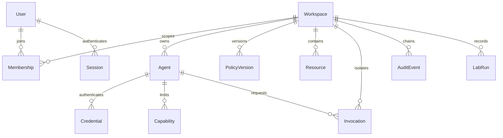
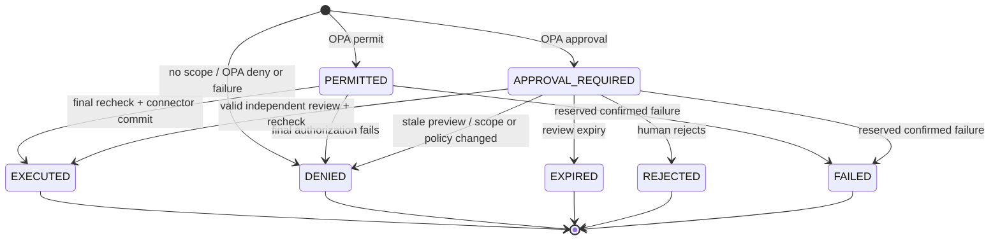

# Architecture

```mermaid
flowchart LR
  A[External agent / TypeScript SDK] -->|Hashed machine identity| G[Express security gateway]
  H[React operator workspace] -->|Session + CSRF + RBAC| G
  G --> C[Capability and resource scope]
  C --> O[OPA / fixed Rego module]
  O -->|Deny| E[Signed audit evidence]
  O -->|Approval| Q[Persisted approval queue]
  Q --> R[Independent human review]
  R --> V[Current identity, scope, policy and resource recheck]
  O -->|Permit| V
  V --> X[Internal synthetic connectors]
  X --> D[(PostgreSQL transaction)]
  D --> E
  E -. explicit consent .-> AI[Optional Gemini explanation]
```



## Authorization sequence

```mermaid
sequenceDiagram
  participant Agent
  participant API
  participant PG as PostgreSQL
  participant OPA
  participant Human
  Agent->>API: Bearer credential + invocation + idempotency key
  API->>PG: Resolve credential and agent workspace
  API->>PG: BEGIN; lock workspace row
  API->>PG: Revalidate identity, key, grant, resource, active policy
  API->>OPA: Trusted structured policy input
  OPA-->>API: DENY / APPROVAL / PERMIT
  alt denied
    API->>PG: Invocation + signed denial evidence; COMMIT
  else approval
    API->>PG: Persist payload hash, resource version, expiry; COMMIT
    Human->>API: Session + CSRF + approve exact hash
    API->>PG: BEGIN; lock; current approver role; single-use transition
    API->>OPA: Re-evaluate with current scope and policy
    API->>PG: Check resource version; synthetic mutation + evidence; COMMIT
  else permitted
    API->>PG: Recheck identity and capability
    API->>OPA: Final authorization recheck
    API->>PG: Synthetic mutation + invocation + evidence; COMMIT
  end
  API-->>Agent: Structured persisted status and trace
```

## Relational model



Approvals, authorization decisions, previews, execution results, idempotency binding, and traces are stored in one Invocation aggregate. Resource rows persist synthetic customers/notes, invoices/payments, and documents. The aggregate avoids cross-table state drift while preserving queryable state and unique constraints. Versioned SQL is the authoritative database deployment artifact.

## Invocation state machine



Synthetic connector exceptions roll back the database transaction and return structured API errors; FAILED is reserved in the contract, not fabricated when execution outcome is unknown. Unknown external connector outcomes are unsupported because no external execution exists.
